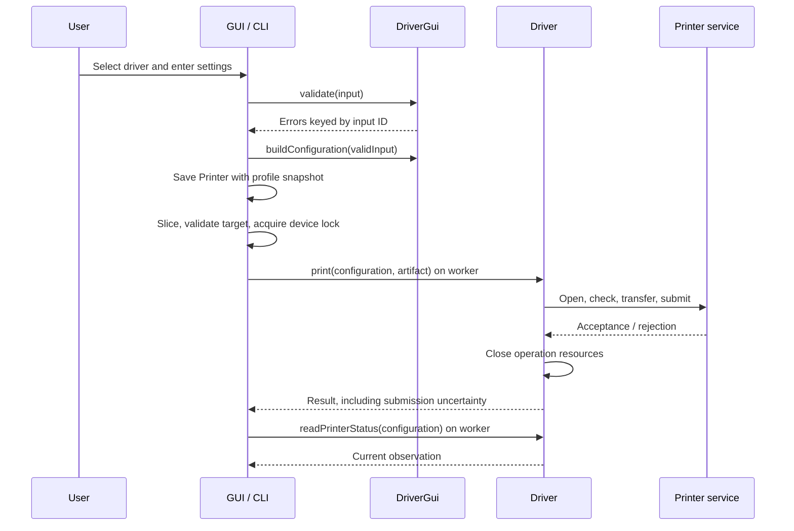

# Write a printer driver

Implement `Driver`, provide a `DriverGui` form, and register your class in a JAR.
The desktop application and CLI use the same implementation. You do not need
JavaFX or application modules to write a plugin.

This walkthrough builds a Java 21 driver named `example-http`. The Java examples
are complete source files. They implement an **illustrative HTTP protocol**, not
an existing printer API. Replace requests and response parsing for your hardware.

## 1. Understand the contract

| Type                  | Responsibility                                                                        |
| --------------------- | ------------------------------------------------------------------------------------- |
| `Driver`              | Integration ID, display name, form, submission and monitoring                         |
| `DriverConfiguration` | Immutable typed connection settings, including credentials                            |
| `Profile`             | Hardware, firmware, output format, and image reference, separate from credentials     |
| `Printer`             | Saved ID, user-facing name, driver ID, configuration, and embedded profile snapshot   |
| `PrintArtifact`       | Validated job bytes, format, SHA-256 checksum, and provenance metadata from model-api |

A driver instance can serve several saved printers. Keep connections and
printer-specific state local to each operation. Metadata methods and form creation
must not connect to hardware. Hosts serialize operations for each physical printer
and run blocking calls off the UI thread; different printers may call your driver
concurrently.



## 2. Create a plugin project

Use this layout:

```text
example-driver/
  build.gradle.kts
  settings.gradle.kts
  src/main/java/example/printer/ExampleDriver.java
  src/main/java/example/printer/ExampleDriverGui.java
  src/main/resources/META-INF/services/dev.voxelbrew.api.printer.driver.Driver
```

For local development, publish the matching BOM and APIs from the VoxelBrew
workspace with `./gradlew publishToMavenLocal` (`.\gradlew.bat` on Windows).
This publishes locally, not to a remote repository. Set
`rootProject.name = "example-driver"` in the plugin's `settings.gradle.kts`.

Use this `build.gradle.kts`, replacing `<version>` with the printer API version
matching your target host:

```kotlin
plugins { java }

java { toolchain { languageVersion.set(JavaLanguageVersion.of(21)) } }

repositories {
    mavenLocal() // Matching APIs published from your local workspace
    mavenCentral()
}

dependencies {
    compileOnly("dev.voxelbrew.api:printer:<version>")
}
```

Match versions to the target host. Use Maven Central for releases and the local
publication steps above for coordinated snapshot development.
`compileOnly` keeps host API classes out of the plugin JAR. This example uses only
the JDK. If you add libraries, distribute their runtime dependencies too. Installed
plugin JARs share a loader: avoid conflicting library versions and never bundle
another copy of the VoxelBrew APIs.

## 3. Define configuration and the form

Save this as `ExampleDriverGui.java`. Input IDs also serve as configuration keys.
Keep them in constants and reuse them in the driver. Stable keys let GUI and CLI
edit settings through `configuration.toInput()` without knowing vendor fields.

```java
package example.printer;

import dev.voxelbrew.api.model.vui.Layout;
import dev.voxelbrew.api.model.vui.PasswordField;
import dev.voxelbrew.api.model.vui.TextField;
import dev.voxelbrew.api.model.vui.VerticalLayout;
import dev.voxelbrew.api.printer.driver.DriverConfiguration;
import dev.voxelbrew.api.printer.driver.DriverGui;
import java.net.URI;
import java.util.LinkedHashMap;
import java.util.Map;

public final class ExampleDriverGui implements DriverGui {
    public static final String URL_ID = "example.url";
    public static final String API_KEY_ID = "example.apiKey";

    @Override
    public Layout layout() {
        return new VerticalLayout(
                new TextField(URL_ID, "Printer service URL", "http://printer.local:8080"),
                new PasswordField(API_KEY_ID, "API key (optional)", ""));
    }

    @Override
    public Map<String, String> validate(Map<String, String> values) {
        var errors = new LinkedHashMap<String, String>();
        try {
            var uri = URI.create(values.getOrDefault(URL_ID, "").trim());
            if (!("http".equals(uri.getScheme()) || "https".equals(uri.getScheme()))
                    || uri.getHost() == null
                    || uri.getUserInfo() != null
                    || uri.getQuery() != null
                    || uri.getFragment() != null
                    || !(uri.getPath().isEmpty() || "/".equals(uri.getPath()))
                    || uri.getPort() == 0
                    || uri.getPort() > 65535) {
                throw new IllegalArgumentException();
            }
        } catch (IllegalArgumentException failure) {
            errors.put(URL_ID, "Enter an HTTP(S) origin without a path, credentials, query, or fragment");
        }
        String key = values.getOrDefault(API_KEY_ID, "");
        if (key.indexOf('\r') >= 0 || key.indexOf('\n') >= 0) {
            errors.put(API_KEY_ID, "API keys must not contain line breaks");
        }
        return Map.copyOf(errors);
    }

    @Override
    public DriverConfiguration buildConfiguration(Map<String, String> values) {
        var errors = validate(values);
        if (!errors.isEmpty()) throw new IllegalArgumentException("Invalid configuration: " + errors);
        return new DriverConfiguration(Map.of(
                URL_ID, URI.create(values.get(URL_ID).trim()),
                API_KEY_ID, values.getOrDefault(API_KEY_ID, "").toCharArray()));
    }
}
```

`validate` accepts incomplete input and collects expected errors keyed by input ID.
Validate again in
`buildConfiguration`, since callers may bypass the form. Neither method performs I/O.

Supported values are `String`, `Integer`, `Boolean`, `BigDecimal`, `URI`, and
`char[]`. Use `URI` for endpoints and `char[]` for secrets. `Long`, `Double`, lists,
nulls, and arbitrary objects are rejected. Configuration copies password arrays on
input and output; use typed accessors rather than casting `properties()`.

`toInput()` returns an immutable string map, including password text and decimals
in plain notation. Use it for editing, never logging. Do not log that map,
`properties()`, request headers, or authenticated URLs. The configuration object's
own `toString()` is redacted.

## 4. Implement submission and monitoring

The example service has this explicit contract:

| Request                                          | Response                                                            |
| ------------------------------------------------ | ------------------------------------------------------------------- |
| `GET /status`                                    | `200` and a `DriverStatus.State` name, such as `IDLE` or `PRINTING` |
| `POST /jobs` with raw G-code                     | `202` means accepted                                                |
| `POST /jobs` returning `400`, `409`, or `415`    | Guaranteed rejection before enqueueing                              |
| Any other submission response or a lost response | Acceptance unknown; inspect the printer                             |

The optional key is sent in `X-API-Key`. These guarantees belong to the example
protocol. Check your real service's semantics before treating a response as proof
of rejection.

Save this as `ExampleDriver.java`:

```java
package example.printer;

import dev.voxelbrew.api.model.printing.PrintArtifact;
import dev.voxelbrew.api.printer.driver.Driver;
import dev.voxelbrew.api.printer.driver.DriverConfiguration;
import dev.voxelbrew.api.printer.driver.DriverGui;
import dev.voxelbrew.api.printer.driver.DriverStatus;
import java.io.IOException;
import java.net.http.HttpClient;
import java.net.http.HttpRequest;
import java.net.http.HttpResponse;
import java.time.Duration;
import java.util.Arrays;
import java.util.OptionalDouble;
import java.util.Set;

public final class ExampleDriver implements Driver {
    private static final System.Logger LOG = System.getLogger(ExampleDriver.class.getName());

    public ExampleDriver() {}

    @Override
    public String id() {
        return "example-http";
    }

    @Override
    public String name() {
        return "Example HTTP printer";
    }

    @Override
    public DriverGui gui() {
        return new ExampleDriverGui();
    }

    @Override
    public PrintResult print(DriverConfiguration configuration, PrintArtifact artifact) {
        boolean submissionAttempted = false;
        boolean accepted = false;
        try {
            validateConfiguration(configuration);
            if (!"gcode".equals(artifact.format())) {
                return new PrintResult.Failure(Set.of("This driver accepts text G-code only"));
            }
            try (var client = openClient()) {
                if (!status(client, configuration).canStart()) {
                    return new PrintResult.Failure(Set.of("Printer is not idle; inspect its current job"));
                }
                var request = request(configuration, "/jobs")
                        .header("Content-Type", "text/plain; charset=utf-8")
                        .POST(HttpRequest.BodyPublishers.ofByteArray(artifact.bytes()))
                        .build();
                submissionAttempted = true;
                var response = client.send(request, HttpResponse.BodyHandlers.discarding());
                int code = response.statusCode();
                if (code == 202) {
                    accepted = true;
                    return PrintResult.Success.SUCCESS;
                }
                if (code == 400 || code == 409 || code == 415) {
                    return new PrintResult.Failure(Set.of("Printer rejected the job (HTTP " + code + ")"));
                }
                return new PrintResult.Failure(
                        Set.of("Submission returned HTTP " + code + "; check the printer before retrying"), true);
            }
        } catch (InterruptedException failure) {
            Thread.currentThread().interrupt();
            return failed("Print operation interrupted", failure, submissionAttempted);
        } catch (IOException | RuntimeException failure) {
            if (accepted) {
                LOG.log(System.Logger.Level.WARNING, "Submission accepted; transport cleanup failed", failure);
                return PrintResult.Success.SUCCESS;
            }
            return failed("Print operation failed; check the printer before retrying", failure, submissionAttempted);
        }
    }

    @Override
    public DriverStatus readPrinterStatus(DriverConfiguration configuration) {
        try {
            validateConfiguration(configuration);
            try (var client = openClient()) {
                return status(client, configuration);
            }
        } catch (InterruptedException failure) {
            Thread.currentThread().interrupt();
            LOG.log(System.Logger.Level.WARNING, "Monitoring interrupted", failure);
            return observation(DriverStatus.State.ERROR, "Monitoring interrupted; reconnect to read status");
        } catch (IOException | RuntimeException failure) {
            LOG.log(System.Logger.Level.WARNING, "Cannot read printer status", failure);
            return observation(DriverStatus.State.ERROR, message("Cannot read printer status", failure));
        }
    }

    private static HttpClient openClient() {
        return HttpClient.newBuilder()
                .connectTimeout(Duration.ofSeconds(5))
                .followRedirects(HttpClient.Redirect.NEVER)
                .build();
    }

    private static void validateConfiguration(DriverConfiguration configuration) {
        var errors = new ExampleDriverGui().validate(configuration.toInput());
        if (!errors.isEmpty()) throw new IllegalArgumentException("Invalid configuration: " + errors);
    }

    private static HttpRequest.Builder request(DriverConfiguration configuration, String path) {
        var builder = HttpRequest.newBuilder(configuration.requireUriProperty(ExampleDriverGui.URL_ID).resolve(path))
                .timeout(Duration.ofSeconds(30));
        char[] key = configuration.requirePasswordProperty(ExampleDriverGui.API_KEY_ID);
        try {
            if (key.length > 0) builder.header("X-API-Key", new String(key));
        } finally {
            Arrays.fill(key, '\0');
        }
        return builder;
    }

    private static DriverStatus status(HttpClient client, DriverConfiguration configuration)
            throws IOException, InterruptedException {
        var response = client.send(
                request(configuration, "/status").GET().build(), HttpResponse.BodyHandlers.ofString());
        if (response.statusCode() != 200) {
            throw new IOException("Status request returned HTTP " + response.statusCode());
        }
        return observation(DriverStatus.State.valueOf(response.body().strip()), "");
    }

    private static DriverStatus observation(DriverStatus.State state, String detail) {
        return new DriverStatus(state, "", OptionalDouble.empty(), OptionalDouble.empty(),
                OptionalDouble.empty(), OptionalDouble.empty(), detail);
    }

    private static PrintResult.Failure failed(String context, Exception failure, boolean uncertain) {
        LOG.log(System.Logger.Level.WARNING, context, failure);
        return new PrintResult.Failure(Set.of(message(context, failure)), uncertain);
    }

    private static String message(String context, Exception failure) {
        String detail = failure.getLocalizedMessage();
        return detail == null || detail.isBlank() ? context : context + ": " + detail;
    }
}
```

The example opens and closes a Java 21 `HttpClient` per operation. It bounds
connection and request waits, and does not retry submission. For protocols with
separate upload and start requests, mark the operation uncertain immediately before
the request that can start a job, not during an upload that cannot start printing.

Read payloads using `artifact.bytes()`. Return `PrintResult.Success.SUCCESS` only
after confirmed acceptance, not completion. Return `Failure(messages, true)` after
an interrupted or failed start request unless you can prove rejection. Never
resubmit automatically to discover whether the first attempt succeeded. Cleanup
failure after confirmed acceptance must not change success to rejection.

Monitoring failures should return `ERROR` with actionable details, as the built-in
drivers do. Missing measurements stay `OptionalDouble.empty()`. Temperatures are
Celsius, progress is a fraction from 0 to 1, and remaining time is seconds. The SPI
permits checked `Exception` for unexpected integration failures; represent expected
operational failures in results/status. Log caught failures with their exception,
preserve root causes in wrappers, and check that vendor exception messages do not
expose credentials.

## 5. Register, build, and install

The file `src/main/resources/META-INF/services/dev.voxelbrew.api.printer.driver.Driver`
must contain the fully qualified implementation class name:

```text
example.printer.ExampleDriver
```

Run `./gradlew jar` with your project's wrapper. Inspect the resulting JAR with
`jar tf build/libs/example-driver.jar` (adjust the filename if you set a version).
It must contain both classes and the service file. Copy it and any required runtime
dependencies to `~/.voxelbrew/plugins`, then restart VoxelBrew. For isolated host
testing, `ApplicationPaths` also honors `-Dvoxelbrew.home=<directory>`.

`ServiceLoader` needs the public no-argument constructor. Choose a unique, stable
`id()`: changing it leaves saved printers referring to the old ID. `name()` is the
display label. There is no `DriverGui.title()` method.

Hosts load the `DriverRegistry` service supplied by `printer-impl`, then configure
its plugin directory. It discovers classpath drivers before sorted lowercase
`.jar` files in that directory. The first duplicate ID wins. Broken services
are logged and skipped. If the driver is missing, check the service filename,
class name, constructor, runtime dependencies, API versions, and duplicate-ID logs.

Hosts can inspect discovery without submitting a job:

```java
package example.printer;

import dev.voxelbrew.api.printer.driver.DriverRegistry;
import java.nio.file.Path;
import java.util.ServiceLoader;

public final class DiscoverDrivers {
    public static void main(String[] args) throws Exception {
        try (var registry = ServiceLoader.load(DriverRegistry.class).findFirst().orElseThrow(
                () -> new IllegalStateException("No DriverRegistry service found; install printer-impl"))) {
            registry.withDirectory(Path.of(args[0]));
            for (var driver : registry.drivers()) {
                System.out.println(driver.id() + "\t" + driver.name());
            }
            var driver = registry.find("example-http").orElseThrow(
                    () -> new IllegalStateException("Install example-driver.jar and restart"));
            System.out.println("Found " + driver.name());
        }
    }
}
```

Keep a registry open until operations using its drivers finish. Closing it releases
its plugin class loaders. Do not keep using captured drivers afterward. A missing
driver is a host error to explain, not a reason to choose another device.

Run this host-side example with `printer-impl` and its dependencies on the runtime
classpath. A driver plugin itself still compiles against printer-api only; do not
bundle the registry implementation in the plugin. Registry loading belongs to the
host, not to a static factory on the API contract.

## 6. Try the GUI and CLI

In printer setup, enter a name, select a hardware profile, then select the driver.
The driver combo starts empty. Your Virtual UI appears inline. Saving calls
`validate` and `buildConfiguration`; editing uses `DriverConfiguration.toInput()`.
Cancellation must not persist a printer.

With a running implementation of the example protocol, the equivalent CLI flow is:

```text
printer device add --device Workshop --driver example-http --profile generic-marlin-200-0.4 --setting example.url=http://localhost:8080 --setting-file example.apiKey=api-key.txt
printer device test --device Workshop
printer status --device Workshop
slicer target set model.vxb --device Workshop
```

These are arguments to the installed VoxelBrew CLI. Put the key in the referenced
file rather than the command line. Select the target before slicing; once the
document contains a compatible sliced artifact, submit it explicitly:

```text
printer print model.vxb --device Workshop
```

The host calls `Printer.validateArtifact(artifact)` before submission. It rejects
another printer's job, changed profile metadata, and profile-only jobs. Your driver
must still validate its own configuration and supported payload format.

## 7. Test before using hardware

Use a local fake service or injected transport. Exercise these cases without a real
printer:

| Scenario                                    | Expected behavior                                                  |
| ------------------------------------------- | ------------------------------------------------------------------ |
| Incomplete/invalid form                     | Field errors; no network access or save                            |
| Save, load, then `toInput()`                | Typed values and field IDs survive; diagnostics omit secrets       |
| Unsupported artifact                        | Failure before transfer or submission                              |
| Busy printer / definite rejection           | Useful failure; no success result                                  |
| Accepted submission                         | Success once; no extra start request                               |
| Connection lost after start request         | `submissionUncertain == true`; no automatic retry                  |
| Invalid status / timeout                    | `ERROR` with details; missing measurements stay empty              |
| Success, rejection, interruption, exception | Resources close; interruption flag restored where applicable       |
| Two configurations using one driver         | No connection or configuration leaks between operations            |
| Packaged plugin                             | Host discovery works; duplicates and broken services are diagnosed |

In VoxelBrew repositories, use JUnit Jupiter with AssertJ. Keep fixtures
deterministic and verify request counts. Physical hardware/firmware qualification
is separate from fixture results.

## Where profiles and saved printers belong

Drivers do not implement persistence. GUI/CLI inject `PrinterStore` and
`PrinterProfileCatalog`; neither has a construction factory or service registration.
The application binds them to `FilePrinterStore` and `DefaultPrinterProfileCatalog`.

Printer JSON lives under `~/.voxelbrew/printers`, with versioning, atomic writes,
and restricted credential permissions. Custom profiles and copied images live
under `~/.voxelbrew/profiles`. Bundled profiles are read-only. Each printer embeds
its chosen snapshot: catalog edits do not silently change configured hardware.
Users explicitly select an updated profile to adopt it.

Documents contain resolved `HardwareSettings`, target IDs, and artifacts, never
driver credentials. Model-api stays independent of printer-api. Standalone-profile
jobs offer artifact export; physical-printer jobs add submission and monitoring.
